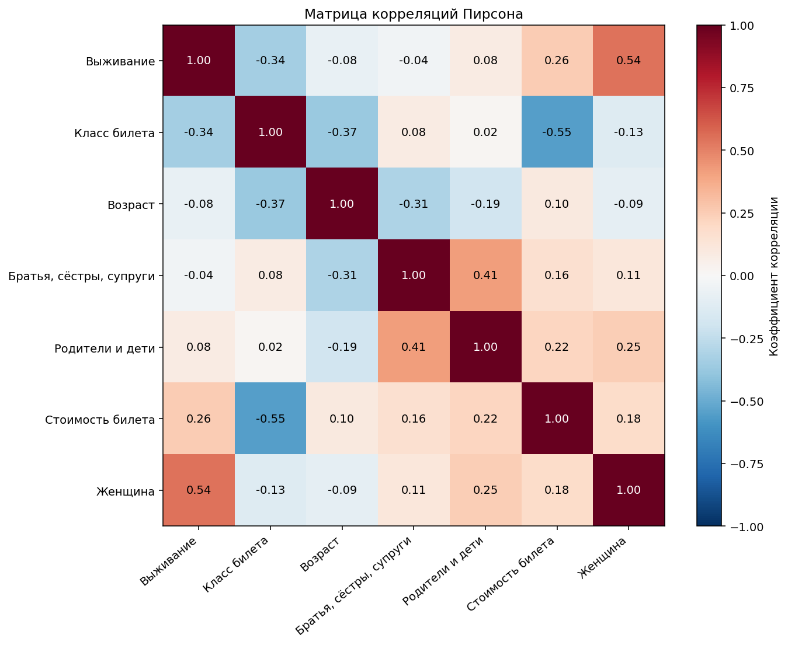

# Лабораторная работа 6 — Логистическая регрессия

## Цель и результат

Реализовать бинарную логистическую регрессию с нуля на Titanic, исследовать влияние скорости обучения, числа итераций и метода оптимизации. Класс 1 означает, что пассажир выжил, класс 0 — погиб.

На обучающей части из **713 пассажиров** обучена 21 модель, каждая оценена на одной и той же тестовой части из **178 пассажиров**. Наибольший тестовый F1 получен у **градиентного спуска с коэффициентом обучения 0.01 и 10 итерациями**: доля верных ответов — **0.8090**, точность — **0.7656**, полнота — **0.7206**, F1 — **0.7424**. Сравнение проведено на одном фиксированном разбиении.

Реализация модели использует NumPy и Pandas; Matplotlib применяется для визуализации. Готовые модели машинного обучения не используются.

## 1 Данные

Источник: [Titanic — Machine Learning from Disaster, Kaggle](https://www.kaggle.com/c/titanic). Использованы уже имеющиеся локальные файлы.

- `titanic/train.csv`: 891 пассажир, 12 столбцов, включая целевую переменную `Survived`.
- `titanic/test.csv`: 418 пассажиров без `Survived`; для расчёта метрик этот файл использовать нельзя.
- `gender_submission.csv`: пример формата отправки, не истинные ответы. В обучении и оценке не используется.

В размеченном наборе 549 погибших (61.62%) и 342 выживших (38.38%). Умеренный дисбаланс учитывается стратифицированным разбиением; дополнительно к accuracy вычисляются precision, recall и F1 положительного класса.

Используемые признаки: `Age` — возраст, `SibSp` — число братьев, сестёр или супругов на борту, `Parch` — число родителей или детей, `Fare` — стоимость билета, `Pclass` — класс билета, `Sex` — пол, `Embarked` — порт посадки.

## 2 Статистика и корреляционный анализ

Статистика рассчитана по исходному размеченному набору **до заполнения пропусков**. `count` — число известных значений, `std` — выборочное стандартное отклонение (ddof=1), 25%, 50% и 75% — квартили. Категориальные коды вроде Pclass в этой таблице описаны численно, но в модели кодируются как категории. Идентификатор PassengerId приведён для полноты, в обучение не входит.

| Признак | Количество | Среднее | Стандартное отклонение | Минимум | Квантиль 25% | Медиана | Квантиль 75% | Максимум |
| --- | --- | --- | --- | --- | --- | --- | --- | --- |
| Номер пассажира | 891.0000 | 446.0000 | 257.3538 | 1.0000 | 223.5000 | 446.0000 | 668.5000 | 891.0000 |
| Выживание | 891.0000 | 0.3838 | 0.4866 | 0.0000 | 0.0000 | 0.0000 | 1.0000 | 1.0000 |
| Класс билета | 891.0000 | 2.3086 | 0.8361 | 1.0000 | 2.0000 | 3.0000 | 3.0000 | 3.0000 |
| Возраст | 714.0000 | 29.6991 | 14.5265 | 0.4200 | 20.1250 | 28.0000 | 38.0000 | 80.0000 |
| Братья, сёстры, супруги | 891.0000 | 0.5230 | 1.1027 | 0.0000 | 0.0000 | 0.0000 | 1.0000 | 8.0000 |
| Родители и дети | 891.0000 | 0.3816 | 0.8061 | 0.0000 | 0.0000 | 0.0000 | 0.0000 | 6.0000 |
| Стоимость билета | 891.0000 | 32.2042 | 49.6934 | 0.0000 | 7.9104 | 14.4542 | 31.0000 | 512.3292 |

Цвет нормирован отдельно внутри каждого столбца статистики; числа в ячейках остаются в исходных единицах. PassengerId исключён из графика, поскольку это идентификатор.

Средний возраст составляет 29.70 года, медианный — 28 лет. У Fare среднее 32.20 заметно выше медианы 14.45; максимум 512.33 и диаграмма размаха показывают правую асимметрию. Выбросы не удалялись: высокая стоимость билета сама по себе не означает ошибку.

Пропуски: Age — 177 (19.87%), Cabin — 687 (77.10%), Embarked — 2 (0.22%). В остальных столбцах train.csv пропусков нет. Таблицы сохранены в `results/statistics.csv` и `results/missing.csv`.

### Корреляционная матрица

Для анализа связей построена матрица Пирсона. Использованы исходные числовые признаки, целевая переменная и индикатор «Женщина»: 1 для женщины, 0 для мужчины. Номер пассажира исключён как идентификатор. Порт посадки не переводится в произвольные числа, поскольку он не имеет естественного порядка. Пропуски не заполняются: каждая пара оценивается по совместно известным значениям. Для пар с возрастом доступны 714 наблюдений, для остальных — 891. Это описательный анализ всего размеченного набора; он не используется для отбора признаков или подбора параметров.

Коэффициент Пирсона для признаков $a$ и $b$:

$$
r_{ab}=\frac{\sum_{i\in I_{ab}}(a_i-\overline a)(b_i-\overline b)}{\sqrt{\sum_{i\in I_{ab}}(a_i-\overline a)^2\sum_{i\in I_{ab}}(b_i-\overline b)^2}},
$$

где $I_{ab}$ — множество объектов с известными значениями обоих признаков, а средние рассчитаны на этом же множестве. Пирсон характеризует линейную связь.

Основные наблюдения:

| Пара признаков | Корреляция Пирсона | Интерпретация |
| --- | --- | --- |
| Женщина и выживание | 0.5434 | У женщин в наборе выше доля выживших |
| Класс билета и выживание | −0.3385 | С ростом номера класса доля выживших уменьшается |
| Стоимость билета и выживание | 0.2573 | Более дорогие билеты связаны с большей долей выживших |
| Класс и стоимость билета | −0.5495 | Больший номер класса связан с более дешёвыми билетами |
| Братья, сёстры, супруги и родители, дети | 0.4148 | Два показателя числа родственников положительно связаны |
| Возраст и выживание | −0.0772 | Простая общая связь слаба; это не исключает нелинейных или групповых различий |

Номер класса имеет порядок 1–3, но равные интервалы между классами условны; коэффициент Пирсона для него интерпретируется с осторожностью. В самой модели класс кодируется индикаторами. Корреляция с бинарной целью описывает различия между группами, а не причинный эффект. Низкая парная корреляция не является достаточным основанием для удаления признака.

Реализация расчётов и визуализации: [модуль plots.py](plots.py). Матрица и числа наблюдений сохранены в `results/correlation_pearson.csv` и `results/correlation_counts.csv`.

## 3 Разбиение и предварительная обработка

Размеченный набор разделён на **обучающую и тестовую выборки в соотношении 80/20** (`seed=42`): 713 объектов для обучения и 178 для тестирования. Разбиение стратифицировано по Survived и реализовано через NumPy. В обучающей части 439 погибших и 274 выживших, в тестовой — 110 погибших и 68 выживших. Пересечений нет, принадлежность пассажиров сохранена в `results/split.csv`. Реализация: [стратифицированное разделение](model.py) (строка 27), [разбиение данных](main.py) (строка 23).

Для экспериментов обработчик обучается исключительно на 713 строках обучающей выборки:

1. Удаляются из набора признаков PassengerId, Name, Ticket и Cabin. Первые три исключены для простой базовой модели без обработки текста и групп билетов; Cabin — из-за большого числа пропусков.
2. Пропуски числовых признаков заменяются обучающими медианами. Получены Age=28, SibSp=0, Parch=0, Fare=14.4542. Даже если в train пропусков Fare нет, обработчик умеет заполнить их в Kaggle test.csv.
3. Пропуски категорий заполняются обучающими модами.
4. One-hot кодирование использует заранее известные категории: Pclass 1/2/3, Sex female/male, Embarked C/Q/S. Базовые категории 1, female и C исключены, чтобы избежать линейной зависимости со свободным членом. Получается 9 признаков.
5. Все 9 столбцов стандартизуются: из значения вычитается обучающее среднее, результат делится на обучающее стандартное отклонение (ddof=0). Нулевая дисперсия заменяется единицей. Свободный член добавляется отдельно и не масштабируется.

Обученные медианы, моды, средние и масштабы применяются к тестовой части без пересчёта. Все комбинации гиперпараметров обучаются на одних и тех же 713 строках. Общая описательная статистика не используется для настройки преобразований. Веса и параметры предобработки по тестовой части не вычисляются.

## 4 Математическая модель и методы обучения

### 4.1 Обозначения и преобразование признаков

Пусть обучающая выборка состоит из пар $(x_i,y_i)$, где $i=1,\ldots,n$, $y_i\in\{0,1\}$. После кодирования категорий у каждого пассажира $d=9$ признаков. Для числового признака $j$ пропуск заменяется медианой $m_j$ обучающей части:

$$
x_{ij}^{\mathrm{зап}}=\begin{cases}x_{ij},&\text{если значение известно},\\m_j,&\text{если значение отсутствует}.\end{cases}
$$

Для категории $c_k$ создаётся индикатор $u_{ik}=\mathbf{1}\{c_i=c_k\}$. Один уровень каждой категории исключается как базовый. Пропущенные категории предварительно заменяются модой обучающей части. Все полученные столбцы стандартизуются:

$$
\mu_j=\frac1n\sum_{i=1}^{n}u_{ij},\qquad
s_j=\sqrt{\frac1n\sum_{i=1}^{n}(u_{ij}-\mu_j)^2},\qquad
\widetilde x_{ij}=\frac{u_{ij}-\mu_j}{s_j}.
$$

Здесь $u_{ij}$ означает значение после заполнения и кодирования; при $s_j=0$ в знаменателе используется 1. Для отложенных данных $m_j$, моды, $\mu_j$ и $s_j$ сохраняются неизменными. Реализация: [кодирование и заполнение пропусков](model.py) (строка 41), [вычисление обучающих статистик](model.py) (строка 51), [стандартизация](model.py) (строка 60).

Добавим свободный член и объединим параметры:

$$
\overline x_i=(1,\widetilde x_{i1},\ldots,\widetilde x_{id})^T,\qquad
\theta=(b,w_1,\ldots,w_d)^T,\qquad
X=\begin{pmatrix}\overline x_1^T\\\vdots\\\overline x_n^T\end{pmatrix}\in\mathbb R^{n\times(d+1)}.
$$

Реализация добавления единичного столбца: [метод design](model.py) (строка 70). Свободный член $b$ не стандартизуется.

### 4.2 Линейный предиктор и сигмоида

Логистическая модель предполагает линейную зависимость логарифма шансов от признаков:

$$
\log\frac{p_i}{1-p_i}=z_i=\overline x_i^T\theta=b+\widetilde x_i^Tw.
$$

Отсюда получаем вероятность выживания и производную сигмоиды:

$$
p_i=\sigma(z_i)=\frac{1}{1+e^{-z_i}},\qquad
\sigma'(z_i)=\frac{e^{-z_i}}{(1+e^{-z_i})^2}=p_i(1-p_i).
$$

Для устойчивости вместо прямой экспоненты используется тождество

$$
\sigma(z)=\exp\bigl(-\log(1+e^{-z})\bigr)
$$

Реализация: [функция sigmoid](model.py) (строка 6). Логиты $X\theta$ вычисляет [decision_function](model.py) (строка 93), вероятности — [predict_proba](model.py) (строка 96).

### 4.3 Правдоподобие и функция потерь

Для бинарного ответа используем распределение Бернулли. При стандартном допущении условной независимости объектов правдоподобие и его логарифм имеют вид

$$
\mathcal L(\theta)=\prod_{i=1}^{n}p_i^{y_i}(1-p_i)^{1-y_i},\qquad
\ell(\theta)=\sum_{i=1}^{n}\left[y_i\log p_i+(1-y_i)\log(1-p_i)\right].
$$

Максимизация правдоподобия эквивалентна минимизации средней отрицательной логарифмической функции правдоподобия — бинарной кросс-энтропии:

$$
J(\theta)=-\frac1n\ell(\theta)
=-\frac1n\sum_{i=1}^{n}\left[y_i\log p_i+(1-y_i)\log(1-p_i)\right].
$$

Подставляя $\log p_i=z_i-\log(1+e^{z_i})$ и $\log(1-p_i)=-\log(1+e^{z_i})$, получаем эквивалентную устойчивую форму:

$$
J(\theta)=\frac1n\sum_{i=1}^{n}\left[\log(1+e^{z_i})-y_i z_i\right]
$$

Её вычисляет [функция log_loss](model.py) (строка 10). Второй аргумент функции — логиты, а не вероятности. Регуляризация в целевую функцию не включена.

### 4.4 Вывод градиента

Для одного объекта обозначим потерю через $J_i$. Применяя цепное правило, получаем

$$
\frac{\partial J_i}{\partial p_i}=-\frac{y_i}{p_i}+\frac{1-y_i}{1-p_i},\qquad
\frac{\partial p_i}{\partial z_i}=p_i(1-p_i),\qquad
\frac{\partial J_i}{\partial z_i}=p_i-y_i.
$$

Поскольку $\partial z_i/\partial\theta=\overline x_i$, для каждого параметра и всего вектора:

$$
\frac{\partial J}{\partial\theta_j}=\frac1n\sum_{i=1}^{n}(p_i-y_i)X_{ij},\qquad
g(\theta)=\nabla J(\theta)=\frac1nX^T(p-y).
$$

В частности, производная по свободному члену равна $\partial J/\partial b=\frac1n\sum_i(p_i-y_i)$. Реализация градиента: [строка grad в методе fit](model.py) (строка 80).

### 4.5 Градиентный спуск

Начальное приближение $\theta^{(0)}=0$. На итерации $t$ вычисляются вероятности и полный градиент по всей обучающей выборке:

$$
p^{(t)}=\sigma(X\theta^{(t)}),\qquad
g^{(t)}=\frac1nX^T(p^{(t)}-y),\qquad
\boxed{\theta^{(t+1)}=\theta^{(t)}-\alpha g^{(t)}}.
$$

По отдельности для свободного члена и весов:

$$
b^{(t+1)}=b^{(t)}-\frac\alpha n\sum_{i=1}^{n}(p_i^{(t)}-y_i),\qquad
w_j^{(t+1)}=w_j^{(t)}-\frac\alpha n\sum_{i=1}^{n}(p_i^{(t)}-y_i)\widetilde x_{ij}.
$$

Здесь $\alpha>0$ — коэффициент обучения, $t=0,\ldots,T-1$, $T$ — заданное число итераций. Это пакетный градиентный спуск. Начальная инициализация находится в [fit](model.py) (строка 74), выбор направления `direction = grad` — в [ветке градиентного спуска](model.py) (строка 81), обновление параметров — в [общем шаге обучения](model.py) (строка 87).

На одной итерации требуется порядка $O(nq)$ операций, где $q=d+1=10$. Для достаточно малого постоянного шага функция потерь убывает. Гарантии для произвольного большого шага нет; в работе исследуется конечная сетка значений.

### 4.6 Гессиан и метод Ньютона

Ещё раз дифференцируя градиент, получаем элементы Гессиана:

$$
H_{jk}(\theta)=\frac{\partial^2 J}{\partial\theta_j\partial\theta_k}
=\frac1n\sum_{i=1}^{n}p_i(1-p_i)X_{ij}X_{ik}.
$$

В матричном виде:

$$
D=\operatorname{diag}\left(p_1(1-p_1),\ldots,p_n(1-p_n)\right),\qquad
H(\theta)=\nabla^2J(\theta)=\frac1nX^TDX.
$$

Для любого вектора $v$ выполнено $v^THv=\frac1n\sum_i p_i(1-p_i)(\overline x_i^Tv)^2\ge0$, поэтому кросс-энтропия выпукла по параметрам. Однако Гессиан может быть вырожденным, а при линейной разделимости конечный минимум без регуляризации может отсутствовать.

Разложение функции потерь около текущего приближения:

$$
J(\theta^{(t)}+\Delta)\approx J(\theta^{(t)})+(g^{(t)})^T\Delta+\frac12\Delta^TH^{(t)}\Delta.
$$

Условие минимума квадратичного приближения: $g^{(t)}+H^{(t)}\Delta=0$. Поэтому классический шаг Ньютона при обратимом Гессиане имеет вид

$$
\Delta^{(t)}=-(H^{(t)})^{-1}g^{(t)},\qquad
\theta^{(t+1)}=\theta^{(t)}-(H^{(t)})^{-1}g^{(t)}.
$$

В реализации добавлены демпфирование $\alpha$ и малая диагональная стабилизация $\varepsilon=10^{-8}$:

$$
\boxed{(H^{(t)}+\varepsilon I_q)s^{(t)}=g^{(t)},\qquad
\theta^{(t+1)}=\theta^{(t)}-\alpha s^{(t)}}.
$$

В коде обратная матрица не строится: система решается через `np.linalg.solve`. Реализация: [Гессиан и решение системы](model.py) (строка 84), [обновление весов](model.py) (строка 87). Выражение `(x.T * (p*(1-p))) @ x` эквивалентно $X^TDX$ и не создаёт плотную матрицу $D$ размера $n\times n$.

Добавление $\varepsilon I_q$ стабилизирует линейную систему, включая свободный член. Это не обучение с L2-штрафом: при L2 изменились бы и функция потерь, и градиент. В нашей модели градиент остаётся $X^T(p-y)/n$.

При $\alpha=1$ используется полный стабилизированный шаг, при $0<\alpha<1$ — укороченный. Автоматического подбора длины шага нет. Одна итерация требует порядка $O(nq^2+q^3)$ операций, поэтому меньшее число итераций само по себе не доказывает меньшее время обучения.

### 4.7 Остановка и классификация

Оба метода выполняют ровно $T$ обновлений, ранняя остановка по норме градиента или функции потерь не применяется. После каждого шага сохраняется $J(\theta^{(t+1)})$, начальное значение также входит в историю. Реализация: [цикл обучения и история потерь](model.py) (строка 77).

Окончательное решение принимается по фиксированному порогу:

$$
\widehat y_i=\begin{cases}1,&\sigma(\overline x_i^T\theta)\ge0.5,\\0,&\sigma(\overline x_i^T\theta)<0.5.\end{cases}
$$

Это эквивалентно проверке $\overline x_i^T\theta\ge0$. Реализация: [метод predict](model.py) (строка 99). Изменение вероятностей без перехода через порог не меняет метки, поэтому улучшение кросс-энтропии не обязано улучшать F1.

## 5 Исследование гиперпараметров

Проверена 21 комбинация. Реализация: [сетка параметров и цикл экспериментов](main.py) (строка 32), [сравнение результатов](main.py) (строка 46), [получение выбранной модели и оценка](main.py) (строка 49).

| Метод | Коэффициент обучения | Число итераций |
| --- | --- | --- |
| Градиентный спуск | 0.001, 0.01, 0.1, 1.0 | 10, 100, 1000 |
| Метод Ньютона | 0.1, 0.5, 1.0 | 5, 10, 30 |

Каждая модель обучается с нулевых весов на обучающей части, после чего на тестовой вычисляются доля верных ответов, точность, полнота, F1 и кросс-энтропия. Для итогового сравнения используется максимальный тестовый F1; при равенстве — меньшая тестовая кросс-энтропия, затем меньшее число итераций и меньший коэффициент обучения.

Все результаты в таблице получены после обучения на 713 объектах и тестирования на 178 объектах. Полные значения и элементы матриц ошибок находятся в `results/experiments.csv`.

| Метод | α | Итерации | Доля верных ответов | Точность | Полнота | F1 | Кросс-энтропия на тесте |
| --- | --- | --- | --- | --- | --- | --- | --- |
| Градиентный спуск | 0.001 | 10 | 0.8034 | 0.7538 | 0.7206 | 0.7368 | 0.6918 |
| Градиентный спуск | 0.001 | 100 | 0.8090 | 0.7656 | 0.7206 | 0.7424 | 0.6799 |
| Градиентный спуск | 0.001 | 1000 | 0.8034 | 0.7619 | 0.7059 | 0.7328 | 0.5925 |
| Градиентный спуск | 0.01 | 10 | 0.8090 | 0.7656 | 0.7206 | 0.7424 | 0.6799 |
| Градиентный спуск | 0.01 | 100 | 0.8034 | 0.7619 | 0.7059 | 0.7328 | 0.5924 |
| Градиентный спуск | 0.01 | 1000 | 0.8090 | 0.7742 | 0.7059 | 0.7385 | 0.4384 |
| Градиентный спуск | 0.1 | 10 | 0.8034 | 0.7619 | 0.7059 | 0.7328 | 0.5913 |
| Градиентный спуск | 0.1 | 100 | 0.8090 | 0.7742 | 0.7059 | 0.7385 | 0.4381 |
| Градиентный спуск | 0.1 | 1000 | 0.7978 | 0.7667 | 0.6765 | 0.7188 | 0.4230 |
| Градиентный спуск | 1 | 10 | 0.8090 | 0.7742 | 0.7059 | 0.7385 | 0.4359 |
| Градиентный спуск | 1 | 100 | 0.7978 | 0.7667 | 0.6765 | 0.7188 | 0.4230 |
| Градиентный спуск | 1 | 1000 | 0.7921 | 0.7541 | 0.6765 | 0.7132 | 0.4228 |
| Метод Ньютона | 0.1 | 5 | 0.7978 | 0.7500 | 0.7059 | 0.7273 | 0.5404 |
| Метод Ньютона | 0.1 | 10 | 0.8034 | 0.7619 | 0.7059 | 0.7328 | 0.4757 |
| Метод Ньютона | 0.1 | 30 | 0.8034 | 0.7705 | 0.6912 | 0.7287 | 0.4249 |
| Метод Ньютона | 0.5 | 5 | 0.8034 | 0.7705 | 0.6912 | 0.7287 | 0.4248 |
| Метод Ньютона | 0.5 | 10 | 0.7921 | 0.7541 | 0.6765 | 0.7132 | 0.4228 |
| Метод Ньютона | 0.5 | 30 | 0.7921 | 0.7541 | 0.6765 | 0.7132 | 0.4228 |
| Метод Ньютона | 1 | 5 | 0.7921 | 0.7541 | 0.6765 | 0.7132 | 0.4228 |
| Метод Ньютона | 1 | 10 | 0.7921 | 0.7541 | 0.6765 | 0.7132 | 0.4228 |
| Метод Ньютона | 1 | 30 | 0.7921 | 0.7541 | 0.6765 | 0.7132 | 0.4228 |

### Влияние параметров

При коэффициенте обучения α=0.001 кросс-энтропия на обучении снижается с 0.6919 после 10 итераций до 0.5997 после 1000. При α=1 и 1000 итерациях она достигает 0.4476. Следовательно, больший шаг ускоряет сходимость в проверенном диапазоне. Расходимости на выбранной сетке не наблюдается.

Метод Ньютона при α=1 достигает обучающей кросс-энтропии около 0.4476 за 5 итераций. При α=0.1 после 5 итераций она равна 0.5523, после 30 — 0.4487. У сошедшихся вариантов обоих методов практически одинаковые потери и метрики. Метод Ньютона требует меньше итераций, но каждая итерация дороже из-за вычисления Гессиана и решения линейной системы; время выполнения не измерялось.

Максимальный тестовый F1=0.7424 получен у градиентного спуска при α=0.001 и 100 итерациях, а также при α=0.01 и 10 итерациях. По дополнительному правилу выбран второй вариант: его тестовая кросс-энтропия немного ниже (0.679874 против 0.679894).

Выбранная модель ещё не сошлась по функции потерь. У сошедшегося метода Ньютона тестовая кросс-энтропия существенно ниже — 0.4228, однако F1 составляет 0.7132. Снижение кросс-энтропии не гарантирует увеличения F1: метки меняются только при переходе вероятностей через порог 0.5. Поэтому большее число итераций улучшает оптимизацию функции потерь, но не обязательно классификационные метрики.

Тестовая выборка используется и для сравнения гиперпараметров, и для представления результата согласно заданию. Поэтому метрики выбранной комбинации характеризуют этот эксперимент; они не являются независимой оценкой после подбора параметров и могут быть оптимистичными.

## 6 Сравнение градиентного спуска и метода Ньютона

Используются доля верных ответов (accuracy), точность положительного класса (precision), полнота (recall) и F1. Положительный класс — выживший пассажир. Обозначения: TP — верно предсказанные выжившие, TN — верно предсказанные погибшие, FP — погибшие, ошибочно отнесённые к выжившим, FN — выжившие, ошибочно отнесённые к погибшим. Метрики вычислены вручную:

$$Accuracy=\frac{TP+TN}{TP+TN+FP+FN},\qquad Precision=\frac{TP}{TP+FP},$$
$$Recall=\frac{TP}{TP+FN},\qquad F1=\frac{2\,Precision\,Recall}{Precision+Recall}.$$

При нулевом знаменателе точность, полнота или F1 принимается равной нулю. Реализация подсчёта элементов матрицы ошибок и метрик: [функция metrics](model.py) (строка 15).

Сравниваются два способа обучения одной и той же логистической регрессии. Для каждого метода выбран лучший вариант из исследованной сетки: максимальный тестовый F1, при равенстве — меньшая тестовая кросс-энтропия, затем меньшее число итераций и меньший коэффициент обучения. Обе модели обучены на **одних и тех же 713 пассажирах**, используют одинаковую предобработку и порог 0.5 и оценены на **одних и тех же 178 пассажирах**. Таким образом, сравнение проводится в одинаковых условиях. Реализация выбора вариантов и сохранения сравнения: [main.py](main.py), блок `method_results`.

| Метод | Коэффициент обучения | Итерации | Доля верных ответов | Точность | Полнота | F1 | Кросс-энтропия на тесте |
| --- | --- | --- | --- | --- | --- | --- | --- |
| Градиентный спуск | 0.01 | 10 | 0.8090 | 0.7656 | 0.7206 | 0.7424 | 0.6799 |
| Метод Ньютона | 0.1 | 10 | 0.8034 | 0.7619 | 0.7059 | 0.7328 | 0.4757 |

| Метод | Верно предсказанные погибшие | Погибшие, ошибочно отнесённые к выжившим | Выжившие, ошибочно отнесённые к погибшим | Верно предсказанные выжившие |
| --- | --- | --- | --- | --- |
| Градиентный спуск | 95 | 15 | 19 | 49 |
| Метод Ньютона | 95 | 15 | 20 | 48 |

Градиентный спуск правильно определил 144 из 178 пассажиров, метод Ньютона — 143. У градиентного спуска на один пропущенный выживший меньше; число ложных положительных ответов одинаково. Разница по доле верных ответов составляет 0.56 процентного пункта, по F1 — около 0.0096 в пользу градиентного спуска. На таком небольшом тестовом наборе это не доказывает общего превосходства метода.

При этом у лучшего по F1 варианта Ньютона ниже тестовая кросс-энтропия: 0.4757 против 0.6799. Если сравнивать варианты после сходимости, оба метода достигают практически одинаковой обучающей кросс-энтропии 0.4476 и тестовой 0.4228, а тестовый F1 равен 0.7132. Метод Ньютона с α=1 достигает этого результата за 5 итераций, градиентный спуск с α=1 — примерно за 1000. Это различие в скорости сходимости по итерациям, а не измерение времени выполнения.

## 7 Выводы

Логистическая регрессия реализована с нуля и обучена двумя методами. Лучший проверенный вариант градиентного спуска имеет F1=0.7424, лучший вариант метода Ньютона — F1=0.7328 на той же тестовой части. При стандартизованных признаках увеличение коэффициента обучения ускоряет снижение функции потерь. Метод Ньютона с полным шагом достигает практически того же минимума за существенно меньшее число итераций, хотя его отдельный шаг требует больше вычислений.

Среди проверенных комбинаций по **F1 на тестовой части при пороге 0.5** лучшими оказались градиентный спуск с α=0.001 и 100 итерациями и с α=0.01 и 10 итерациями. По меньшей тестовой кросс-энтропии выбран второй вариант. Его доля верных ответов — 80.90%, F1 — 0.7424. Если критерием служит качество вероятностей по кросс-энтропии, предпочтительнее сошедшийся вариант, например метод Ньютона с α=1 и 5 итерациями: тестовая кросс-энтропия около 0.4228 вместо 0.6799 у выбранного по F1 варианта.
