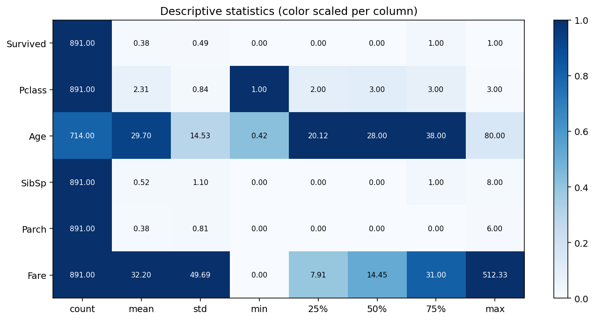
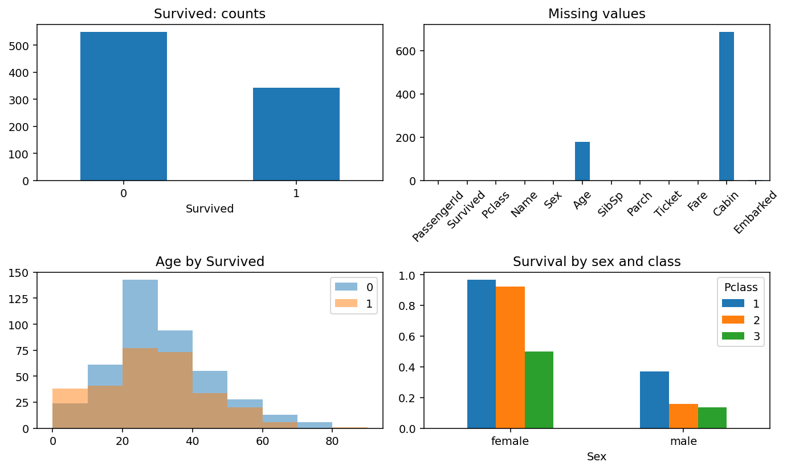
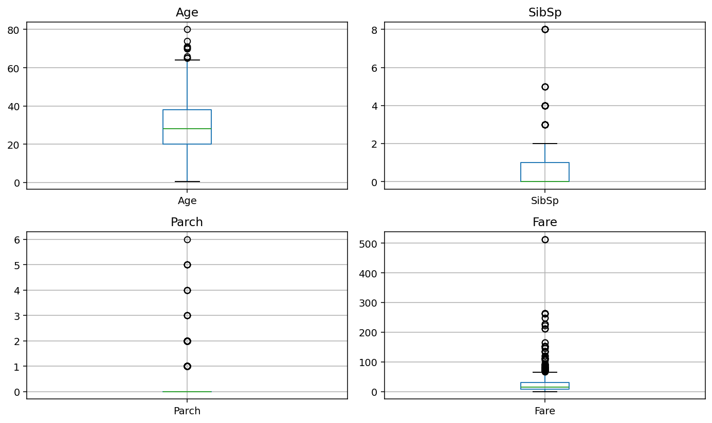
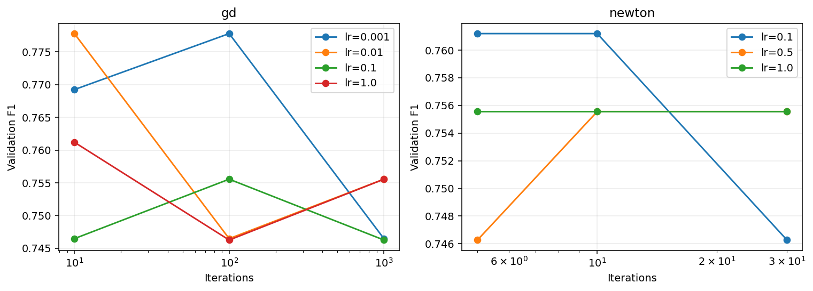
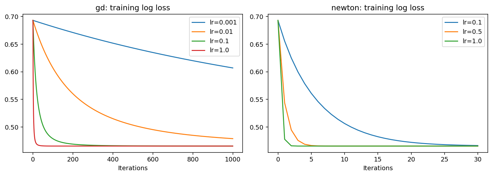
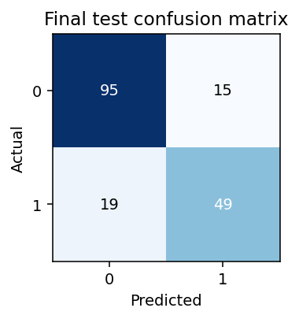

# Лабораторная работа 6 — Логистическая регрессия

## Цель и результат

Реализовать бинарную логистическую регрессию с нуля на Titanic, исследовать влияние скорости обучения, числа итераций и метода оптимизации. Класс 1 означает, что пассажир выжил, класс 0 — погиб.

По максимальному F1 на валидационной выборке выбран **градиентный спуск, learning rate 0.01, 10 итераций**. После переобучения на объединённых обучающей и валидационной частях получены **accuracy 0.8090, precision 0.7656, recall 0.7206, F1 0.7424** на тестовой части. Это результат одного фиксированного разбиения, а не оценка качества для любого разбиения.

## Запуск

Требуется Python 3.10 или новее. Проверено на Python 3.12, NumPy 2.1.2, Pandas 2.2.3 и Matplotlib 3.9.2.

```bash
python3 -m venv .venv
source .venv/bin/activate
python -m pip install -r requirements.txt
python main.py
python -m unittest -v
```

Параметры путей при необходимости:

```bash
python main.py --data-dir titanic --output results
```

При обычном запуске пути определяются относительно `main.py`. Программа сохраняет CSV, JSON и PNG в `results/`; готовые результаты уже включены в проект. Генерация графиков работает без графического интерфейса. При предупреждении о недоступном каталоге кеша Matplotlib можно запустить `MPLCONFIGDIR=/tmp/lab6-matplotlib python main.py`.

Реализация модели, метрик, разбиения и предобработки использует только **NumPy и Pandas**. Matplotlib нужен исключительно для визуализации. Библиотеки готового машинного обучения не используются. Стандартная библиотека Python используется для файлов, параметров запуска и тестирования.

## 1 Данные

Источник: [Titanic — Machine Learning from Disaster, Kaggle](https://www.kaggle.com/c/titanic). Использованы уже имеющиеся локальные файлы.

- `titanic/train.csv`: 891 пассажир, 12 столбцов, включая целевую переменную `Survived`.
- `titanic/test.csv`: 418 пассажиров без `Survived`; для расчёта метрик этот файл использовать нельзя.
- `gender_submission.csv`: пример формата отправки, не истинные ответы. В обучении и оценке не используется.

В размеченном наборе 549 погибших (61.62%) и 342 выживших (38.38%). Умеренный дисбаланс учитывается стратифицированным разбиением; дополнительно к accuracy вычисляются precision, recall и F1 положительного класса.

Используемые признаки: `Age` — возраст, `SibSp` — число братьев, сестёр или супругов на борту, `Parch` — число родителей или детей, `Fare` — стоимость билета, `Pclass` — класс билета, `Sex` — пол, `Embarked` — порт посадки.

## 2 Статистика и визуализация

Статистика рассчитана по исходному размеченному набору **до заполнения пропусков**. `count` — число известных значений, `std` — выборочное стандартное отклонение (ddof=1), 25%, 50% и 75% — квартили. Категориальные коды вроде Pclass в этой таблице описаны численно, но в модели кодируются как категории. Идентификатор PassengerId приведён для полноты, в обучение не входит.

| Признак | count | mean | std | min | 25% | 50% | 75% | max |
| --- | --- | --- | --- | --- | --- | --- | --- | --- |
| PassengerId | 891.0000 | 446.0000 | 257.3538 | 1.0000 | 223.5000 | 446.0000 | 668.5000 | 891.0000 |
| Survived | 891.0000 | 0.3838 | 0.4866 | 0.0000 | 0.0000 | 0.0000 | 1.0000 | 1.0000 |
| Pclass | 891.0000 | 2.3086 | 0.8361 | 1.0000 | 2.0000 | 3.0000 | 3.0000 | 3.0000 |
| Age | 714.0000 | 29.6991 | 14.5265 | 0.4200 | 20.1250 | 28.0000 | 38.0000 | 80.0000 |
| SibSp | 891.0000 | 0.5230 | 1.1027 | 0.0000 | 0.0000 | 0.0000 | 1.0000 | 8.0000 |
| Parch | 891.0000 | 0.3816 | 0.8061 | 0.0000 | 0.0000 | 0.0000 | 0.0000 | 6.0000 |
| Fare | 891.0000 | 32.2042 | 49.6934 | 0.0000 | 7.9104 | 14.4542 | 31.0000 | 512.3292 |



Цвет нормирован отдельно внутри каждого столбца статистики; числа в ячейках остаются в исходных единицах. PassengerId исключён из графика, поскольку это идентификатор.





Средний возраст составляет 29.70 года, медианный — 28 лет. У Fare среднее 32.20 заметно выше медианы 14.45; максимум 512.33 и диаграмма размаха показывают правую асимметрию. Выбросы не удалялись: высокая стоимость билета сама по себе не означает ошибку. На графике доли выживших видны различия по полу и классу билета; это описательная связь, не доказательство причинности.

Пропуски: Age — 177 (19.87%), Cabin — 687 (77.10%), Embarked — 2 (0.22%). В остальных столбцах train.csv пропусков нет. Таблицы сохранены в `results/statistics.csv` и `results/missing.csv`.

## 3 Разбиение и предварительная обработка

Сначала отложено 20% размеченных данных для тестирования (`seed=42`), затем 25% оставшейся части выделено для валидации (`seed=43`). Получены **535 train, 178 validation, 178 test**, приблизительно 60/20/20. Обе операции стратифицированы по Survived и реализованы через NumPy. Пересечений нет, принадлежность пассажиров сохранена в `results/split.csv`.

Для экспериментов обработчик обучается исключительно на 535 строках train:

1. Удаляются из набора признаков PassengerId, Name, Ticket и Cabin. Первые три исключены для простой базовой модели без обработки текста и групп билетов; Cabin — из-за большого числа пропусков.
2. Пропуски числовых признаков заменяются обучающими медианами. Получены Age=28, SibSp=0, Parch=0, Fare=14. Даже если в train пропусков Fare нет, обработчик умеет заполнить их в Kaggle test.csv.
3. Пропуски категорий заполняются обучающими модами.
4. One-hot кодирование использует заранее известные категории: Pclass 1/2/3, Sex female/male, Embarked C/Q/S. Базовые категории 1, female и C исключены, чтобы избежать линейной зависимости со свободным членом. Получается 9 признаков.
5. Все 9 столбцов стандартизуются: из значения вычитается обучающее среднее, результат делится на обучающее стандартное отклонение (ddof=0). Нулевая дисперсия заменяется единицей. Свободный член добавляется отдельно и не масштабируется.

Обученные медианы, моды, средние и масштабы применяются к validation и test без пересчёта. После выбора гиперпараметров обработчик и модель заново обучаются на 713 строках train+validation. Тестовая часть остаётся отложенной. Общая описательная статистика не используется для настройки преобразований.

## 4 Реализация логистической регрессии

Код находится в `model.py`. Все веса, включая свободный член, инициализируются нулями. Вероятность положительного класса:

$$z_i=b+x_i^T w,\qquad p_i=\sigma(z_i)=\frac{1}{1+e^{-z_i}}.$$

Для численной устойчивости сигмоида вычисляется через `exp(-logaddexp(0, -z))`. Целевая функция — средняя бинарная кросс-энтропия:

$$L=\frac{1}{n}\sum_{i=1}^n[\log(1+e^{z_i})-y_i z_i].$$

В коде `log_loss(y, logits)` принимает **логиты**, не вероятности, и использует `np.logaddexp`. Это предотвращает переполнение экспоненты и вычисление логарифма нуля.

Пусть X уже содержит столбец единиц, а θ объединяет b и w. Градиент и Гессиан:

$$g=\frac{X^T(p-y)}{n},\qquad H=\frac{X^T D X}{n},\qquad D=\operatorname{diag}(p_i(1-p_i)).$$

- Градиентный спуск: θ ← θ − αg.
- Метод Ньютона с управляемой длиной шага: θ ← θ − α(H + εI)⁻¹g, ε=10⁻⁸. Решается линейная система через `np.linalg.solve`, обратная матрица явно не вычисляется. Добавка служит численной стабилизацией Гессиана; L2-штраф в функции потерь отсутствует.

Выполняется ровно заданное число итераций, автоматической ранней остановки нет. История потерь включает состояние до первого обновления. Для классификации установлен фиксированный порог p ≥ 0.5. Коэффициент α в методе Ньютона означает демпфирование шага, поэтому одинаковые α у разных методов не означают одинаковые обновления.

Пример самостоятельного обучения после подготовки массивов:

```python
from model import LogisticRegression
model = LogisticRegression(learning_rate=0.1, n_iter=1000, optimizer='gd')
model.fit(X_train, y_train)
predictions = model.predict(X_test)
probabilities = model.predict_proba(X_test)
```

## 5 Исследование гиперпараметров

Проверена 21 комбинация:

| Метод | Learning rate | Число итераций |
| --- | --- | --- |
| Градиентный спуск (gd) | 0.001, 0.01, 0.1, 1.0 | 10, 100, 1000 |
| Метод Ньютона (newton) | 0.1, 0.5, 1.0 | 5, 10, 30 |

Заранее принято правило выбора: **максимум validation F1**, при равенстве — минимум validation log loss, затем меньше итераций и меньший learning rate. Тестовые метрики каждой комбинации показаны по требованию задания, однако в алгоритме выбора они не участвуют. Для корректного дальнейшего исследования нельзя перенастраивать модель по этой тестовой таблице; потребуется новое разбиение или вложенная кросс-валидация.





В следующей таблице **Val F1** используется для выбора; остальные четыре метрики рассчитаны на тестовых 178 строках для моделей, обученных на 535 строках. Полные значения, validation log loss и элементы матриц ошибок находятся в `results/experiments.csv`.

| Метод | α | Итерации | Val F1 | Test accuracy | Test precision | Test recall | Test F1 |
| --- | --- | --- | --- | --- | --- | --- | --- |
| gd | 0.0010 | 10 | 0.7692 | 0.8090 | 0.7500 | 0.7500 | 0.7500 |
| gd | 0.0010 | 100 | 0.7778 | 0.8034 | 0.7463 | 0.7353 | 0.7407 |
| gd | 0.0010 | 1000 | 0.7465 | 0.7865 | 0.7273 | 0.7059 | 0.7164 |
| gd | 0.0100 | 10 | 0.7778 | 0.8034 | 0.7463 | 0.7353 | 0.7407 |
| gd | 0.0100 | 100 | 0.7465 | 0.7865 | 0.7273 | 0.7059 | 0.7164 |
| gd | 0.0100 | 1000 | 0.7556 | 0.8090 | 0.7742 | 0.7059 | 0.7385 |
| gd | 0.1000 | 10 | 0.7465 | 0.7865 | 0.7273 | 0.7059 | 0.7164 |
| gd | 0.1000 | 100 | 0.7556 | 0.8090 | 0.7742 | 0.7059 | 0.7385 |
| gd | 0.1000 | 1000 | 0.7463 | 0.8034 | 0.7705 | 0.6912 | 0.7287 |
| gd | 1.0000 | 10 | 0.7612 | 0.8146 | 0.7869 | 0.7059 | 0.7442 |
| gd | 1.0000 | 100 | 0.7463 | 0.8034 | 0.7705 | 0.6912 | 0.7287 |
| gd | 1.0000 | 1000 | 0.7556 | 0.8034 | 0.7705 | 0.6912 | 0.7287 |
| newton | 0.1000 | 5 | 0.7612 | 0.8034 | 0.7619 | 0.7059 | 0.7328 |
| newton | 0.1000 | 10 | 0.7612 | 0.8146 | 0.7869 | 0.7059 | 0.7442 |
| newton | 0.1000 | 30 | 0.7463 | 0.8034 | 0.7705 | 0.6912 | 0.7287 |
| newton | 0.5000 | 5 | 0.7463 | 0.8146 | 0.7778 | 0.7206 | 0.7481 |
| newton | 0.5000 | 10 | 0.7556 | 0.8034 | 0.7705 | 0.6912 | 0.7287 |
| newton | 0.5000 | 30 | 0.7556 | 0.8034 | 0.7705 | 0.6912 | 0.7287 |
| newton | 1.0000 | 5 | 0.7556 | 0.8034 | 0.7705 | 0.6912 | 0.7287 |
| newton | 1.0000 | 10 | 0.7556 | 0.8034 | 0.7705 | 0.6912 | 0.7287 |
| newton | 1.0000 | 30 | 0.7556 | 0.8034 | 0.7705 | 0.6912 | 0.7287 |

### Влияние параметров

При α=0.001 градиентный спуск после 10 итераций имеет train loss 0.6920, близкий к начальному ln(2)=0.6931. При 1000 итерациях он снижается до 0.6070. При α=1 и 1000 итерациях достигается 0.4656: больший шаг ускоряет сходимость в исследованном диапазоне. Расходимости в проверенных конфигурациях не обнаружено; это не гарантия для произвольно больших шагов.

Метод Ньютона при α=1 достигает train loss около 0.4656 за 5 итераций; последующие обновления почти не меняют результат. При α=0.1 сходимость медленнее: за 5 итераций loss равен 0.5611, за 30 — 0.4665. Сошедшиеся варианты обоих методов дают практически одинаковые потери и классификационные метрики. Ньютону требуется меньше итераций, но одна его итерация дороже из-за вычисления Гессиана и решения линейной системы; время выполнения здесь не измерялось.

Максимальный validation F1=0.7778 получен у gd с α=0.001 и 100 итерациями и с α=0.01 и 10 итерациями. По дополнительному правилу выигрывает второй вариант: его validation log loss немного меньше (0.680214 против 0.680234).

Это **недообученная по log loss модель**, хотя её F1 выше: вероятности остаются близкими к 0.5, но их расположение относительно порога даёт удачные метки. У сошедшейся модели validation log loss гораздо ниже (около 0.4055), а F1 — 0.7556. Поэтому низкая кросс-энтропия не гарантирует максимальный F1 на конечной выборке. Увеличение числа итераций не даёт монотонного улучшения F1; на него влияют переходы отдельных объектов через порог 0.5. Нельзя по этому результату утверждать, что 10 итераций вообще лучше 1000 или что вероятности выбранной модели хорошо откалиброваны.

## 6 Оценка итоговой модели

Метрики положительного класса вычислены вручную:

$$Accuracy=\frac{TP+TN}{TP+TN+FP+FN},\qquad Precision=\frac{TP}{TP+FP},$$
$$Recall=\frac{TP}{TP+FN},\qquad F1=\frac{2\,Precision\,Recall}{Precision+Recall}.$$

При нулевом знаменателе соответствующая precision, recall или F1 принимается равной нулю.

После выбора параметров модель с gd, α=0.01 и 10 итерациями обучена с нуля на **713 пассажирах** и оценена на тех же отложенных **178 пассажирах**. Поэтому итоговые значения отличаются от строки в таблице экспериментов, где обучение проводилось на 535 пассажирах.

| Модель | Accuracy | Precision | Recall | F1 | Log loss |
| --- | --- | --- | --- | --- | --- |
| Итоговая логистическая регрессия | 0.8090 | 0.7656 | 0.7206 | 0.7424 | 0.6799 |
| Базовая модель «всегда погиб» | 0.6180 | 0.0000 | 0.0000 | 0.0000 | — |

Большинство для базовой модели определено по train+validation. Для неё сравниваются только метрики меток: вероятностная модель для baseline не задавалась.



| Фактический класс | Предсказан 0 | Предсказан 1 |
| --- | --- | --- |
| 0 — погиб | TN=95 | FP=15 |
| 1 — выжил | FN=19 | TP=49 |

Модель правильно определила 144 из 178 пассажиров. Из 68 выживших найдены 49, пропущены 19. Среди 64 предсказанных выживших 49 действительно выжили. По accuracy получено улучшение примерно на 19.10 процентного пункта относительно постоянного большинства.

Для 418 строк `titanic/test.csv` сохранён `results/submission.csv`. Он получен той же итоговой моделью, обученной на 713 размеченных строках. Метрики для этого файла неизвестны, поскольку истинных ответов нет; отправка на Kaggle не выполнялась.

## 7 Выводы

Логистическая регрессия реализована с нуля и превосходит классификатор большинства на выбранной тестовой части. При стандартизованных признаках увеличение learning rate ускоряет снижение функции потерь. Метод Ньютона с полным шагом достигает практически того же минимума за существенно меньшее число итераций, хотя его отдельный шаг требует больше вычислений.

Для **заранее выбранного критерия validation F1 при пороге 0.5** лучшими среди проверенных оказались gd, learning rate 0.01 и 10 итераций. Финальная тестовая accuracy равна 80.90%, F1 — 0.7424. Если приоритетом являются вероятности и log loss, разумнее рассматривать сошедшийся вариант, например Newton с α=1 и 5 итерациями; у него существенно меньше validation log loss. Его нельзя объявлять лучшим по F1.

Результаты ограничены одним небольшим разбиением и простой линейной моделью. Часть пассажиров могла путешествовать семьями или по общим билетам; обычная стратификация не гарантирует независимости таких групп. Дальнейшие улучшения: кросс-валидация с учётом групп пассажиров, L2-регуляризация и настройка порога на валидации. В данной работе эти эксперименты не проводились.

## Файлы и проверка

| Файл | Назначение |
| --- | --- |
| `model.py` | Предобработка, разделение, сигмоида, log loss, GD, Newton и метрики |
| `main.py` | Полный воспроизводимый эксперимент и построение графиков |
| `test_model.py` | Проверки численной устойчивости, градиента и Гессиана конечными разностями, сходимости двух методов, разбиения, предобработки и метрик |
| `requirements.txt` | Зависимости |
| `results/experiments.csv` | Все 21 комбинации с метриками |
| `results/summary.json` | Параметры и итоговые тестовые метрики |
| `results/statistics.csv`, `results/missing.csv` | Описательная статистика и пропуски |
| `results/split.csv` | Зафиксированное разбиение по PassengerId |
| `results/coefficients.csv` | Итоговые веса в стандартизованном пространстве и свободный член |
| `results/loss_history.json` | История train loss каждого эксперимента |
| `results/figures/` | Шесть графиков, включённых в отчёт |
| `results/submission.csv` | Предсказания для Kaggle test.csv |

Выполнено `python3 -m unittest -v`: **6 тестов, все прошли**. Градиент и Гессиан сверены с центральными конечными разностями; на синтетических несепарабельных данных сошедшиеся GD и Newton дают совпадающие веса с точностью 10⁻⁶. Также проверены отсутствие пересечений и воспроизводимость разбиения, сохранение статистик обработчика при преобразовании отложенных данных и известный пример метрик.
